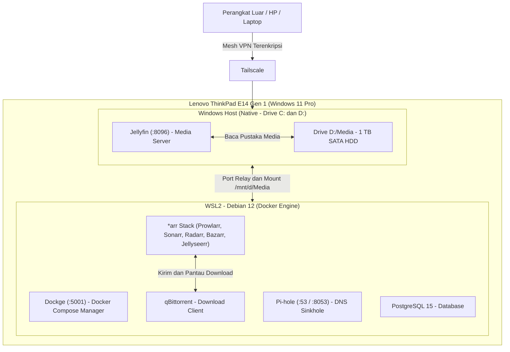

Di [tulisan sebelumnya](/posts/dari-wsl-ke-homelab-docker-dan-era-ai/), saya sempat cerita singkat soal perjalanan dari sekadar ngoprek WSL di laptop kerja sampai akhirnya nyulap laptop bekas di rumah jadi *home lab* yang jalan 24/7. Nah, di catatan kali ini saya mau bedah lebih dalam arsitektur di balik layar `nadir-thinkpad` — mulai dari kenapa pilihannya jatuh ke **hybrid Windows 11 + WSL2**, kenapa **ThinkPad E14 Gen 1** terasa pas banget buat peran ini, pembagian RAM di `.wslconfig`, sampai trik merawat laptop supaya kuat nyala nonstop.

Kalau kamu lagi kepikiran bikin server rumahan tapi belum pengen beli mini PC baru atau rakit PC khusus, semoga *breakdown* ini bisa kasih gambaran realistis yang gampang ditiru.

---

## Kenapa Hybrid Windows 11 + WSL2 (Bukan Full Linux atau Proxmox)?

Secara teori, kalau ngomongin *home lab* yang "ideal" versi buku teks, jawabannya hampir pasti: hapus Windows, install **Proxmox VE** atau **Ubuntu Server** *bare-metal*, beres. Bersih, minim *overhead*, dan murni ekosistem Linux.

Tapi di dunia nyata, skenarionya sering kali nggak sehitam-putih itu.

Alasan paling jujurnya simpel: ThinkPad ini masih punya **peran ganda**. Selain jadi server rumahan yang nangkring terus di meja, laptop ini juga masih aktif saya pakai sebagai **workstation harian untuk ngoding, kerja, dan eksperimen bareng AI agent**.

Kalau saya paksa *full* Linux atau Proxmox di *bare-metal*:
* Setiap kali butuh ekosistem Windows yang *native* — entah itu *tools* kerja tertentu, aplikasi GUI yang udah nyaman dipakai, atau sekadar ngetes sesuatu di lingkungan Windows — saya harus ribet bikin VM lagi atau gonta-ganti mesin.
* Di laptop, urusan manajemen daya, *driver* perangkat keras, sampai kontrol baterai kadang jauh lebih mulus langsung ditangani oleh Windows tanpa banyak *tuning* manual.

Dengan pendekatan **hybrid Windows 11 Pro + WSL2 (Debian 12)**, saya justru dapat titik tengah yang paling praktis:
1. **Windows 11 jadi tuan rumah sekaligus workstation:** semua urusan kerja harian, repo lokal, sampai layanan yang enak jalan *native* seperti **Jellyfin** bisa langsung jalan dengan akses penuh ke *hardware* (termasuk akselerasi GPU Intel) dan *drive* NTFS lokal.
2. **WSL2 Debian 12 jadi rumah buat seluruh container:** di balik layar, semua *stack* server mulai dari manajemen Docker, DNS, otomasi media, sampai database jalan rapi dan terisolasi di dalam **Docker** di lingkungan Linux asli.

Memang ada sedikit *overhead* memori dibanding Linux murni, tapi buat kebutuhan *home lab* skala keluarga sekaligus mesin kerja harian, fleksibilitasnya jauh lebih terasa.

---

## Kenapa Lenovo ThinkPad E14 Gen 1 Itu "Sweet Spot"

Banyak orang mikir bikin *home server* itu identik sama rak besi penuh kipas berisik atau mini PC mahal. Padahal, **laptop bekas kelas bisnis** seperti Lenovo ThinkPad generasi Intel Core ke-10 sering kali jauh lebih masuk akal — harganya terjangkau di pasar *second*, *build*-nya bandel, dan komponennya gampang dirawat.

Ini spesifikasi ringkas ThinkPad yang saya pakai:

| Komponen | Spesifikasi | Catatan Peran di Homelab |
| :--- | :--- | :--- |
| **Perangkat** | Lenovo ThinkPad E14 (Gen 1) | Ringkas, senyap, dan hemat tempat |
| **CPU** | Intel Core i5-10210U (4C/8T, TDP 15W) | Hemat listrik 24/7 + punya **Intel Quick Sync** buat *hardware transcoding* Jellyfin |
| **RAM** | 16 GB DDR4 | Cukup lega buat *workstation* + belasan *container* Docker sekaligus |
| **Storage 1** | 512 GB NVMe SSD (`C:\`) | OS Windows 11, WSL2, *image* Docker, PostgreSQL 15, & *workspace dev* |
| **Storage 2** | 1 TB 2.5" SATA HDD (`D:\Media`) | Pustaka film/serial Jellyfin & folder unduhan *\*arr stack* |
| **Jaringan** | 1 Gbps Ethernet LAN | Koneksi kabel stabil buat *streaming* dan transfer data lokal |
| **Daya** | Baterai internal | Berfungsi sebagai **UPS alami** kalau listrik rumah tiba-tiba padam |

Ada tiga detail kecil dari tabel di atas yang bikin ThinkPad E14 Gen 1 ini terasa pas banget:

### 1. Kombinasi Dual-Drive NVMe + SATA 2.5" Itu Krusial
Salah satu kelebihan laptop generasi ini adalah masih punya slot **M.2 NVMe** dan *bay* **2.5" SATA** sekaligus. Pemisahan dua *storage* ini bukan cuma soal nambah kapasitas, tapi soal kesehatan dan performa sistem:
* **NVMe SSD (`C:\`) buat beban I/O tinggi:** Windows, *virtual disk* WSL2, *image* Docker, database **PostgreSQL 15**, sampai aktivitas baca-tulis ribuan file kecil pas ngoding butuh *random IOPS* yang kencang. Ditaruh di NVMe bikin sistem dan *container* tetap responsif tanpa *lag*.
* **SATA HDD (`D:\Media`) buat beban sekuensial & torrent:** Aktivitas *download* dan *seeding* di **qBittorrent** plus penyimpanan file video puluhan gigabyte buat **Jellyfin** itu penuh operasi tulis berulang dan sifatnya sekuensial. Kalau dicampur ke SSD utama, NVMe bakal cepat sesak dan kena beban tulis tinggi tiap hari. Dipisah ke HDD 1 TB bikin NVMe tetap lega dan awet, sementara ruang media tetap murah dan aman.

### 2. Irit Daya tapi Masih Jago Transcoding
Prosesor **i5-10210U** punya TDP 15W, jadi tagihan listrik bulanan nggak bakal kerasa membengkak walaupun nyala nonstop. Di saat yang sama, iGPU bawaannya sudah mendukung **Intel Quick Sync Video**, jadi pas ada perangkat yang nonton Jellyfin dan butuh *transcode* resolusi secara *real-time*, CPU nggak langsung megap-megap di 100%.

### 3. Baterai Internal = UPS Gratis
Di server mini PC atau PC rakitan biasa, kalau listrik rumah mati mendadak atau sekadar *jeglek* sebentar, sistem langsung mati total — dan itu rawan bikin database atau *filesystem* WSL2 korup. Pakai laptop bekas berarti kamu otomatis sudah punya **UPS bawaan**. Listrik padam? Laptop tetap jalan santai pakai baterai, dan kita masih punya cukup waktu buat nunggu listrik nyala lagi atau *shutdown* dengan aman.

---

## Peta Besar Arsitektur Homelab

Biar kebayang gimana semua komponen tadi saling ngobrol — dari HP di luar rumah sampai ke *container* di dalam WSL2 — kurang lebih alurnya seperti ini:



Singkatnya, jalur utamanya terbagi dua lapis:
* **Pintu masuk aman lewat Tailscale:** Dari HP atau laptop di luar jaringan rumah, semua akses masuk lewat *mesh* VPN terenkripsi milik Tailscale tanpa perlu repot buka *port forwarding* di router ISP.
* **Jembatan Windows <-> WSL2:** Layanan yang butuh akses langsung ke *hardware* dan *storage* media seperti **Jellyfin (`:8096`)** jalan *native* di Windows sambil membaca `D:\Media`. Sementara di sebelahnya, **WSL2 Debian 12** menjalankan Docker untuk mengurus **Dockge (`:5001`)**, **Pi-hole (`:53`/`8053`)**, ekosistem **\*arr stack + qBittorrent** (yang mengakses `D:\Media` lewat *mount* `/mnt/d/Media`), serta **PostgreSQL 15** untuk kebutuhan database aplikasi. Detail tiap *container* dan pelajaran soal *hardlink* sudah saya catat juga di halaman [Homelab](/homelab/).

---

## Mengatur Napas RAM & CPU lewat `.wslconfig` & Pembagian Peran

Kalau kamu pernah menjalankan Docker di atas WSL2 dengan setelan *default*, pasti sudah nggak asing sama satu proses di Task Manager bernama **`vmmemWSL`** (atau `Vmmem`). Secara bawaan, WSL2 memang boleh mengambil jatah sampai 50% total RAM Windows dan seluruh *logical processor* yang tersedia. Di atas kertas kelihatannya aman, tapi dalam praktiknya, kernel Linux di WSL2 sangat agresif memakai RAM yang nganggur untuk *page cache* — dan kalau dibiarkan tanpa rem, memori yang sudah dipakai *container* atau proses *build* sering kali nggak langsung balik ke Windows Host.

Akibatnya klasik: pas lagi *build* proyek berat seperti **Next.js** atau **NestJS** sambil nyalain Docker, `vmmemWSL` bisa terus membengkak sampai Windows Host kehabisan napas, lemot parah, bahkan *hang*. Kondisi ini makin terasa kalau laptop yang sama juga dipakai jalanin layanan *native* di Windows seperti **Jellyfin** — alih-alih jadi server rumahan yang santai, laptop malah gampang ngos-ngosan rebutan *resource*.

### Membatasi Resource WSL2 dengan `.wslconfig`

Karena ThinkPad E14 yang saya pakai punya **16 GB RAM** dan CPU **4 Cores / 8 Threads** (i5-10210U), pembagian yang paling aman buat pemakaian 24/7 adalah **10 GB untuk Windows Host** dan **6 GB untuk WSL2**. Untuk ngatur batas globalnya, kita cukup bikin file `.wslconfig` di folder profil Windows (`C:\Users\<username>\.wslconfig` atau `%UserProfile%\.wslconfig`):

```ini
[wsl2]
memory=6GB
swap=2GB
processors=4

[experimental]
autoMemoryReclaim=gradual
```

Penjelasan singkat tiap barisnya:
* **`memory=6GB`** — Batas keras (*hard limit*) RAM untuk VM WSL2. Dengan angka 6 GB, seluruh *stack* Docker tetap punya ruang gerak yang lega, sementara Windows Host masih kebagian sisa 10 GB yang nyaman buat OS, Jellyfin, maupun kerjaan harian lainnya.
* **`swap=2GB`** — Ruang cadangan di disk kalau suatu saat pemakaian memori di dalam WSL2 tiba-tiba melonjak (misalnya pas lagi *compile* atau *indexing* berat). Cukup 2 GB aja supaya *container* nggak gampang kena *OOM killer* tanpa bikin disk kerja terlalu keras.
* **`processors=4`** — Membatasi VM WSL2 maksimal memakai 4 *logical processor* (separuh dari total 8 *thread* i5-10210U). Jadi sepadat apa pun proses di dalam Docker, Windows Host tetap kebagian napas CPU yang responsif.
* **`autoMemoryReclaim=gradual`** — Ditaruh di bawah seksi `[experimental]`, opsi ini nyuruh WSL2 pelan-pelan ngelepasin *cached memory* yang udah nggak dipakai balik ke Windows Host saat sistem mulai *idle*. Jadi `vmmemWSL` nggak numpuk terus setelah *build* atau aktivitas berat selesai.

> Setelah membuat atau mengubah file `.wslconfig`, pengaturannya nggak langsung aktif. Jalankan `wsl --shutdown` lewat PowerShell atau Windows Terminal supaya VM WSL2 mati total dulu, lalu buka ulang distro Debian-nya.
{: .prompt-tip }

### Pembagian Peran: Mana yang di Windows, Mana yang di WSL2?

Supaya 16 GB RAM dan CPU 4 core itu kepakai efektif tanpa saling sikut, saya pisahin tugas layanannya secara tegas antara **Windows Host** dan **WSL2 Debian 12**:

| Lingkungan | Layanan | Alasan Teknis |
| :--- | :--- | :--- |
| **Windows 11 (Native)** | **Jellyfin** | Akses langsung ke iGPU **Intel Quick Sync** untuk *hardware transcoding* dan baca tulis langsung ke drive `D:\Media` tanpa *overhead* virtualisasi maupun jembatan DrvFs (`/mnt/d`). |
| **WSL2 (Debian 12)** | **Dockge, Pi-hole, *\*arr stack*, qBittorrent, & PostgreSQL 15** | Semua layanan jaringan, otomasi media, *download client*, sampai database untuk proyek *development* jauh lebih nyaman dikelola pakai Docker Compose di ekosistem Linux yang ringan dan terisolasi. |

Pembagian seperti ini bikin tiap sisi kerja sesuai kelebihannya. Jellyfin nggak perlu ribet urusan *GPU passthrough* atau I/O *filesystem* lintas VM saat *streaming* film ke Smart TV, sementara urusan *container* tetap dapet lingkungan Linux yang rapi, gampang di-*backup*, dan nggak pernah nyerobot jatah RAM Windows Host lagi.

#### Kenapa Jellyfin Tetap Bertahan Native di Windows (Bukan di Docker WSL2)?

Jujur aja, di awal saya sempat pengen banget naro **Jellyfin** sekalian ke dalam Docker Compose di WSL2 biar satu atap sama \*arr stack. Kelihatannya rapi, tinggal satu `compose.yaml` buat semuanya.

Tapi begitu urusan masuk ke **hardware transcoding**, ceritanya langsung beda:
* Di Linux *bare-metal*, mengaktifkan **Intel Quick Sync** di container Jellyfin itu gampang — tinggal *pass* device `/dev/dri` ke Docker dan beres.
* Di **WSL2**, akses GPU nggak lewat *node* VA-API standar seperti `/dev/dri/renderD128` secara langsung, melainkan lewat lapisan paravirtualisasi **Direct3D 12 (`/dev/dxg`)**.
* Saya sempat coba berbagai cara: utak-atik driver, coba *mapping* device di Docker Desktop, sampai ngecek kompatibilitas transcode di dalam container. Hasilnya tetap ribet, nggak konsisten, atau ujung-ujungnya malah jatuh ke *software transcoding* yang bikin CPU i5-10210U langsung mentok 100% dan kipas laptop meraung.

Akhirnya saya ambil keputusan paling pragmatis: **Jellyfin tetap bertahan *native* di Windows**. Di Windows, tinggal aktifkan opsi **Intel QuickSync (QSV)** di pengaturan *Playback* Jellyfin, *hardware transcoding* langsung jalan mulus, suhu laptop adem, dan akses ke `D:\Media` jauh lebih kencang tanpa jembatan DrvFs (`/mnt/d`). Kadang solusi terbaik di homelab memang bukan yang paling "seragam", tapi yang paling stabil dipakai sehari-hari.

> Kalau kamu juga menjalankan PostgreSQL 15 atau *service* database lain di WSL2, pastikan *memory limit* di `.wslconfig` nggak terlalu mepet — alokasi 6 GB itu sudah angka aman untuk menampung *stack* homelab harian sekaligus ngasih ruang kalau sesekali dipakai *build* Next.js/NestJS.
{: .prompt-info }

---

## Jaringan: Pi-hole & Tailscale (Tanpa Port Forwarding)

Punya *media server* dan tumpukan *container* di rumah rasanya kurang lengkap kalau urusan jaringannya masih berantakan atau cuma bisa dinikmati pas lagi duduk di ruang tamu. Untuk urusan jaringan, saya mengandalkan dua layanan utama yang tugasnya saling melengkapi: **Pi-hole** untuk menyaring lalu lintas di dalam rumah, dan **Tailscale** untuk akses aman dari luar rumah.

### Pi-hole: DNS Sinkhole untuk Satu Rumah

Di jaringan lokal, semua permintaan domain lewat dulu ke **Pi-hole** yang jalan sebagai DNS *sinkhole*. Begitu DNS rumah diarahkan ke IP laptop server, semua perangkat — mulai dari HP, laptop kerja, sampai Smart TV — otomatis terlindungi tanpa perlu repot pasang *ad-blocker* satu per satu.

Saat ini saya memasang *blocklist* dengan lebih dari **431.000 domain** berisi daftar penyedia iklan, *tracker*, dan telemetri. Begitu ada aplikasi atau situs yang mencoba menghubungi domain di daftar tersebut, Pi-hole langsung memblokirnya di level DNS sebelum sempat dimuat. Efeknya terasa banget: *browsing* lebih bersih, aplikasi HP lebih minim iklan, dan jaringan rumah jadi sedikit lebih lega.

> Sebelum mengubah pengaturan DNS langsung di level router untuk semua orang di rumah, coba tes dulu di satu perangkat (misalnya HP atau laptop kamu sendiri). Pastikan semua layanan atau aplikasi yang sering dipakai keluarga tetap jalan normal tanpa ada domain penting yang ikut terblokir.
{: .prompt-tip }

### Tailscale: Akses Aman dari Luar Rumah Tanpa Buka Port

Pertanyaan berikutnya: gimana kalau lagi di luar kota atau di kafe dan pengen nonton koleksi film di **Jellyfin**, cek kondisi *container* di **Dockge**, atau sekadar *request* tontonan baru?

Saya memilih **tidak pernah membuka *port forwarding* di router rumah** ke internet publik. Selain berisiko dari sisi keamanan, sebagian besar internet rumahan di Indonesia juga sudah berada di balik CGNAT, sehingga buka port di router sering kali memang nggak mempan.

Solusinya adalah **Tailscale**, *mesh VPN* berbasis **WireGuard** yang ringan dan nyaris tanpa konfigurasi ribet. Cukup pasang Tailscale di laptop server dan di perangkat yang kamu bawa (HP atau laptop lain), lalu login dengan akun yang sama. Keduanya langsung terhubung lewat jalur terenkripsi *peer-to-peer* menggunakan IP privat Tailscale, seolah-olah lagi berada di satu jaringan Wi-Fi yang sama.

Mau buka Jellyfin di port `8096` atau ngecek log di Dockge dari jaringan seluler? Tinggal nyalakan *toggle* Tailscale di HP, akses alamat IP Tailscale server, dan beres — tanpa perlu mengekspos satu port pun ke internet umum.

> Hindari membuka *port forwarding* router langsung ke layanan manajemen seperti Dockge, qBittorrent, atau dashboard admin lainnya. Menggunakan VPN seperti Tailscale jauh lebih aman karena layananmu sama sekali tidak terlihat dari internet publik.
{: .prompt-warning }

---

## Trik Merawat Laptop Server 24/7 di Windows

Menjalankan laptop bekas sebagai server 24/7 di atas Windows tentu beda perlakuannya dibanding pakai server Linux murni. Supaya laptop nggak gampang *sleep* sendiri, nggak macet setelah mati lampu, dan *hardware*-nya tetap awet bertahun-tahun, ini beberapa setelan wajib yang saya terapkan:

### 1. Wajib Pakai Kabel LAN 1 Gbps
Jangan pernah andalkan Wi-Fi untuk server rumah, apalagi kalau dipakai buat *streaming* media dari **Jellyfin** sekaligus menjalankan aktivitas unduhan *\*arr stack* di latar belakang. Sambungkan laptop langsung ke router atau *switch* pakai kabel Ethernet **1 Gbps**. Koneksi kabel bikin latensi jauh lebih stabil, *bandwidth* konsisten saat transfer file besar, dan bebas dari drama Wi-Fi putus mendadak di tengah malam.

### 2. Setting Power & Lid Close (Tutup Layar, Server Tetap Nyala)
Biar laptop server bisa ditaruh rapi di pojok meja tanpa menyilaukan ruangan, layarnya harus bisa ditutup tanpa bikin sistem ikut tidur:
* Buka **Control Panel → Power Options → Choose what closing the lid does**.
* Pada bagian **When I close the lid**, ubah opsi **Plugged in** menjadi **Do nothing**.
* Masuk juga ke **Change plan settings**, lalu atur **Put the computer to sleep** (saat *Plugged in*) ke **Never**.
* Di **Change advanced power settings**, pastikan hard disk penyimpanan media (`D:\Media`) tidak terlalu agresif dimatikan sistem (set *Turn off hard disk after* ke `0` / *Never* jika perlu) supaya akses Jellyfin selalu responsif.

> Kalau laptop dinyalakan 24/7 dengan layar tertutup, pastikan sirkulasi udaranya tetap aman. Hindari menaruh laptop di atas kain atau menumpuk barang di atasnya, dan beri sedikit ruang di bagian bawah (misalnya pakai ganjalan sederhana atau *stand*) agar panas dari prosesor dan HDD tetap bisa keluar lancar.
{: .prompt-tip }

### 3. Docker Delayed Start Lewat Task Scheduler
Di *setup* hybrid Windows + WSL2, ada satu skenario klasik yang sering bikin jengkel: habis mati lampu atau Windows *restart* otomatis karena *update*, Windows-nya nyala lagi, tapi Docker Desktop gagal jalan karena berebut *startup* sebelum jaringan dan WSL2 siap.

Triknya, matikan opsi *Start Docker Desktop when you sign in to your computer* di pengaturan Docker, lalu buat jadwal *delayed start* lewat **Task Scheduler** Windows:
1. Buat tugas baru (*Create Task*) dan aktifkan opsi agar jalan meski pengguna belum login atau pakai *auto-login* sesuai kebutuhan *setup*-mu.
2. Di tab **Triggers**, pilih **At startup** (atau *At log on*), lalu centang **Delay task for: `1 minute`** (atau `2 minutes`) untuk memberi waktu Windows, driver jaringan LAN, dan WSL2 siap terlebih dahulu.
3. Di tab **Actions**, pilih **Start a program** dan arahkan ke `C:\Program Files\Docker\Docker\Docker Desktop.exe`.
4. Di tab **Conditions**, pastikan opsi berhenti otomatis saat berpindah ke baterai dimatikan, supaya kalau listrik sempat kedip sebentar tugas ini tidak ikut dibatalkan.

Dengan cara ini, kalau suatu saat Windows *restart* sendiri, tunggu sekitar 1–2 menit dan seluruh *container* Docker (yang sudah diset `restart: unless-stopped`) bakal otomatis bangkit lagi tanpa perlu kamu sentuh.

### 4. Menjaga Kesehatan Baterai sebagai UPS Alami
Seperti dibahas di awal, baterai internal laptop adalah UPS gratis. Masalahnya, kalau laptop dicolok *charger* 24/7 dengan baterai terus-terusan dipaksa penuh di **100%**, sel baterainya bakal cepat stres, panas, dan ujung-ujungnya gampang **kembung**.

Untungnya di ThinkPad (dan kebanyakan laptop modern lain), kita bisa mengaktifkan fitur **Battery Charge Threshold** lewat **Lenovo Vantage** atau menu **BIOS**:
* Atur batas atas pengisian (*stop charging at*) di kisaran **60%–80%** (saya pribadi pakai batas **80%**).
* Atur batas bawah (*start charging below*) misalnya di **75%** agar baterai tidak terus-terusan melakukan siklus cas mikro.

Begitu kapasitas menyentuh angka batas tersebut, daya dari adaptor akan langsung menopang mesin tanpa terus mengisi baterai. Hasilnya, baterai tetap awet, adem, tidak gampang kembung meski dicolok 24/7, dan tetap punya cadangan tenaga yang cukup buat menahan pemadaman listrik singkat.

> Meski sudah pakai *Battery Charge Threshold*, tetap biasakan cek fisik area *palmrest* atau *trackpad* setiap beberapa bulan sekali. Kalau terasa mulai menggelembung, segera cabut dan ganti baterainya demi keamanan perangkat yang nyala tanpa pengawasan 24/7.
{: .prompt-warning }

---

## Penutup

Membuat *home lab* nggak harus selalu dimulai dari beli *hardware* baru atau format total laptop ke Linux server. Dengan memadukan **Lenovo ThinkPad E14 Gen 1**, **Windows 11 + WSL2 Debian 12**, pembagian RAM yang rapi di `.wslconfig`, serta **Pi-hole + Tailscale**, satu laptop bekas sudah lebih dari cukup untuk jadi tulang punggung media, jaringan rumah, sekaligus *workstation* harian.

Tentu saja *setup* hybrid seperti ini bukan berarti bebas drama — mulai dari port container yang tiba-tiba diblokir `winnat` Windows sampai terminal `cmd.exe` yang bikin proses *freeze* karena nggak sengaja terklik. Kisah-kisah *troubleshooting* nyata di balik pemakaian harian itu bakal saya tulis di catatan berikutnya!
