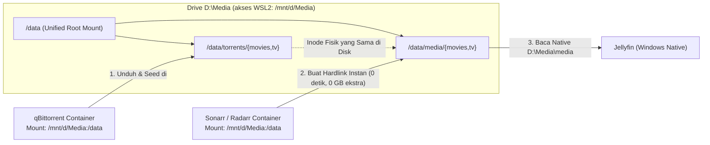

Di [artikel sebelumnya](/posts/homelab-thinkpad-hybrid-windows-wsl2-docker-tailscale/), saya sudah membedah arsitektur di balik `nadir-thinkpad` — laptop Lenovo ThinkPad E14 Gen 1 yang saya sulap jadi server rumahan 24/7 sekaligus *workstation* harian dengan mengawinkan **Windows 11 Pro**, **WSL2 Debian 12**, **Docker**, **Jellyfin**, **Pi-hole**, dan **Tailscale**.

Di atas kertas (dan di diagram arsitektur), semuanya kelihatan rapi dan mulus. Tapi namanya juga ngoprek sistem *hybrid* yang menyatukan dua dunia — kernel Windows NT di satu sisi dan kernel Linux WSL2 di sisi lain — tentu saja perjalanannya nggak bebas dari drama.

Ada momen ketika *container* yang kemarin jalan normal tiba-tiba gagal *start* habis Windows *reboot*, proses server yang mendadak membeku gara-gara satu klik mouse yang nggak disengaja, sampai hard disk yang kerja keras dua kali lipat waktu memindahkan film.

Sesuai janji saya di penutup tulisan kemarin, artikel ini merangkum **4 drama nyata yang saya alami sendiri** selama menjalankan homelab *hybrid* ini sehari-hari, ditambah **4 kasus klasik paling populer dari komunitas WSL2 & *self-hosted* luar** yang wajib kamu antisipasi kalau membangun *setup* serupa.

---

## Bagian 1: Drama Nyata di Meja Kerja (`nadir-thinkpad`)

Empat kasus pertama ini adalah "jebakan" yang benar-benar kejadian di mesin saya sendiri saat *setup* awal maupun pemakaian harian.

### 1. Port Container Tiba-Tiba Diblokir `winnat` (`excludedportrange`)

#### Gejala
Semua *container* di Dockge kemarin jalan normal. Tapi setelah Windows melakukan *restart* (entah karena *update* atau habis mati lampu), tiba-tiba salah satu *container* atau database gagal menyala dengan pesan *error* klasik seperti ini:

```text
Error response from daemon: Ports are not available: exposing port TCP 0.0.0.0:5001 -> 0.0.0.0:0: listen tcp 0.0.0.0:5001: bind: An attempt was made to access a socket in a way forbidden by its access permissions.
```

Anehnya, waktu dicek pakai `netstat -ano | findstr :5001`, **sama sekali nggak ada aplikasi lain yang lagi memakai port tersebut**.

#### Penyebab
Biang keroknya adalah layanan **Windows NAT Driver (`winnat`)** dan **Hyper-V**. Setiap kali Windows *booting*, Hyper-V secara otomatis mencadangkan sejumlah blok port dinamis (*excluded port ranges*) untuk kebutuhan internal jaringan virtualnya. Masalahnya, pemilihan rentang port ini sering kali acak — dan kalau kebetulan port favorit *container*-mu (misalnya `5001` milik Dockge, `5432` milik PostgreSQL, atau `8080`) masuk ke dalam rentang yang dicaplok Hyper-V, aplikasi apa pun tidak akan diizinkan melakukan *bind* ke sana.

Untuk membuktikannya, buka PowerShell atau Windows Terminal dan jalankan:

```powershell
netsh interface ipv4 show excludedportrange protocol=tcp
```

Kalau port *container* yang gagal tadi berada di antara angka `Start Port` dan `End Port` yang muncul di layar, berarti positif kena blokir `winnat`.

#### Solusi Cepat & Permanen
Untuk pertolongan pertama saat itu juga, buka **PowerShell sebagai Administrator** lalu *restart* layanan `winnat`:

```powershell
net stop winnat
net start winnat
```

Begitu `winnat` dinyalakan ulang, port yang tadinya terkunci biasanya langsung lepas dan *container* Docker bisa langsung dinyalakan kembali.

> **Solusi Permanen:** Supaya port-port penting homelab kamu nggak pernah dicaplok lagi oleh Hyper-V saat *reboot* berikutnya, daftarkan port tersebut ke daftar reservasi permanen ketika kondisi port sedang kosong:
> ```powershell
> netsh int ipv4 add excludedportrange protocol=tcp startport=5001 numberofports=1 store=persistent
> ```
> Port yang ada tanda bintang (`*`) di daftar `show excludedportrange` menandakan port tersebut sudah diamankan dari alokasi acak dinamis.
{: .prompt-tip }

---

### 2. Proses Server *Freeze* Mendadak Gara-Gara *QuickEdit Mode* di `cmd.exe`

#### Gejala
Kamu lagi menjalankan proses server, *script* otomasi, atau *worker* di jendela Command Prompt (`cmd.exe`) atau *console window* bawaan Windows. Dari luar kelihatannya jendela terminal masih terbuka normal dan tidak ada pesan *error* sama sekali, tapi **layanannya mendadak nggak merespons (*hang*)**. Begitu kamu masuk ke jendela terminal itu dan menekan tombol `Enter` atau `Esc`, tiba-tiba log-nya muncrat keluar semua dan server kembali jalan normal seolah baru bangun dari pingsan.

#### Penyebab
Ini salah satu jebakan paling konyol tapi nyata di Windows: fitur **QuickEdit Mode** di `cmd.exe` / Windows Console Host (`conhost.exe`).

Saat *QuickEdit Mode* aktif (dan secara *default* memang aktif di Windows), **satu klik kiri mouse yang tidak sengaja mendarat di dalam area hitam terminal** akan langsung mengubah status jendela menjadi mode seleksi teks (*Select*). Selama ada satu kotak putih kecil yang terblok di layar, Windows **menahan seluruh arus *output* (`stdout`)** agar teks di layar tidak bergeser saat disalin. Akibatnya? Begitu aplikasi server mencoba mencetak satu baris log saja ke layar, prosesnya langsung *blocking* dan membeku total sampai seseorang menekan `Enter` atau `Esc` untuk membatalkan seleksi!

#### Solusi
Ada tiga langkah yang langsung saya terapkan supaya drama klik tak sengaja ini nggak pernah kejadian lagi:

1. **Matikan *QuickEdit Mode* di `cmd.exe`:**
   Klik kanan pada *title bar* jendela `cmd.exe` → pilih **Defaults** (dan lakukan juga di **Properties**) → pada tab **Options**, hapus centang pada **QuickEdit Mode** → klik **OK**.
2. **Gunakan Windows Terminal untuk Sesi Interaktif:**
   Seperti yang pernah saya bahas di [tulisan soal Windows Terminal](/posts/windows-terminal-cli/), terminal modern ini punya penanganan *buffer* dan seleksi teks yang jauh lebih cerdas tanpa sembarangan membekukan proses di belakang layar.
3. **Jangan Jalankan Layanan 24/7 di Jendela Terminal Terbuka:**
   Untuk layanan *native* Windows seperti **Jellyfin**, pastikan jalan sebagai **Windows Service** atau lewat *background tray/Task Scheduler*, sedangkan layanan lainnya masukkan ke dalam *container* Docker dengan `restart: unless-stopped`.

---

### 3. Jebakan *Hardlink* & Disk Kerja Dua Kali di *\*arr Stack* (`/mnt/d/Media`)

#### Gejala
Waktu pertama kali merakit ekosistem otomasi media (**Sonarr**, **Radarr**, dan **qBittorrent**) di dalam Docker WSL2, semuanya berfungsi: film berhasil diunduh, lalu otomatis dipindahkan ke folder koleksi **Jellyfin**.

Tapi setiap kali satu film berukuran 15–20 GB selesai diunduh di `D:\Media`:
* Proses status *"Importing"* di Sonarr/Radarr makan waktu lama banget.
* Lampu indikator aktivitas hard disk SATA 1 TB (`D:\`) berkedip kencang tanpa henti.
* Selama file masih di-*seed* di qBittorrent, pemakaian ruang hard disk jadi **bengkak dua kali lipat** (20 GB di folder `downloads` + 20 GB di folder `movies`).

#### Penyebab
Kesalahan klasiknya ada di cara mendefinisikan *volume mapping* di `compose.yaml`. Di konfigurasi bawaan banyak panduan internet, orang sering memisahkan titik *mount* seperti ini:

```yaml
# ❌ JANGAN DITIRU: Dua mount terpisah bikin hardlink gagal!
volumes:
  - /mnt/d/Media/downloads:/downloads
  - /mnt/d/Media/movies:/movies
```

Walaupun di Windows aslinya sama-sama berada di dalam satu partisi `D:\Media`, di mata *container* Linux Docker, `/downloads` dan `/movies` dianggap sebagai **dua *filesystem* (*mount point*) yang berbeda**.

Dalam aturan sistem operasi, fitur **Hardlink** dan **Atomic Move** (pindah lokasi file secara instan tanpa menyalin isi datanya) **tidak pernah bisa menyeberangi dua *mount point* yang berbeda**. Akibatnya, Sonarr dan Radarr terpaksa melakukan operasi *Copy + Delete* secara fisik byte demi byte!

#### Solusi: *Unified Volume Mount* (Gaya TRaSH Guides)
Seperti yang sempat saya singgung di halaman [Homelab](/homelab/), solusinya adalah menyatukan seluruh struktur media di bawah **satu titik *mount* induk yang sama** (misalnya `/mnt/d/Media` di-*mount* menjadi `/data`), lalu baru membagi subfolder di dalamnya:



Contoh penerapan rapi di `compose.yaml`:

```yaml
# ✅ BENAR: Satu unified mount (/data) membuat hardlink jalan instan
services:
  qbittorrent:
    image: lscr.io/linuxserver/qbittorrent:latest
    volumes:
      - ./config/qbittorrent:/config
      - /mnt/d/Media:/data

  radarr:
    image: lscr.io/linuxserver/radarr:latest
    volumes:
      - ./config/radarr:/config
      - /mnt/d/Media:/data
```

Dengan struktur tunggal `/data` ini:
* Begitu unduhan selesai di `/data/torrents/movies`, Radarr langsung membuat **hardlink** ke `/data/media/movies` dalam hitungan **milidetik**.
* File bisa tetap di-*seed* di qBittorrent sekaligus muncul rapi di Jellyfin **tanpa memakan kapasitas hard disk dua kali**.
* Umur hard disk 2.5" laptop jauh lebih awet karena bebas dari siksaan *copy-paste* puluhan gigabyte setiap hari.

---

### 4. Lambatnya I/O Lintas OS (`/mnt/c` DrvFs vs Filesystem `ext4` Native)

#### Gejala
Saat mengerjakan proyek koding (seperti **Next.js** atau **NestJS**) dari dalam terminal WSL2, atau saat menaruh folder database/konfigurasi *container* di folder Windows (`C:\Users\...` yang diakses lewat `/mnt/c/...`), performanya terasa berat luar biasa:
* `npm install` atau `pnpm build` makan waktu berkali-kali lipat lebih lama dibanding biasanya.
* Fitur *hot-reload* saat ngoding kadang nggak mendeteksi perubahan file.
* Container yang memakai database **SQLite** (seperti Sonarr, Radarr, Prowlarr) atau **PostgreSQL 15** kadang mengeluh `database is locked` atau terasa lambat saat membuka *dashboard*.

#### Penyebab
Di arsitektur WSL2, drive Windows yang muncul di `/mnt/c` atau `/mnt/d` diakses melewati lapisan protokol jaringan lokal bernama **9P (DrvFs)**. Jembatan ini harus menerjemahkan izin file Linux ke NTFS Windows (beserta pengecekan *antivirus* Windows Defender) untuk setiap satu file yang disentuh.

Kalau kamu membuka **1 file film berukuran 10 GB** di `/mnt/d/Media`, jembatan DrvFs sama sekali nggak masalah karena operasinya bersifat *sequential read* pada satu file besar. Tapi kalau kamu menaruh **`node_modules` yang isinya 50.000 file kecil** atau file *Write-Ahead Logging (WAL)* database di `/mnt/c`, *overhead* translasi per file-nya bakal langsung mencekik performa I/O!

#### Solusi: Aturan Emas Pembagian Lokasi File
Jangan pernah mencampur lokasi penyimpanan. Di `nadir-thinkpad`, saya menerapkan aturan tegas ini:

| Jenis Data | Lokasi Wajib | Alasan Teknis |
| :--- | :--- | :--- |
| **Source code proyek (`git`), `node_modules`, data PostgreSQL 15, & folder `/config` Docker** | **Di dalam Linux WSL2 Native** (`~/projects`, `~/stacks`, `/var/lib/docker`) pada NVMe SSD | Berjalan langsung di atas *filesystem* `ext4` virtual disk dengan kecepatan I/O mendekati Linux *bare-metal* dan mendukung *file locking* POSIX penuh. |
| **File video besar (Film, Serial TV, Musik) & hasil unduhan torrent** | **Di Drive Windows `D:\Media`** (diakses WSL2 lewat `/mnt/d/Media`) | Berisi sedikit file berukuran besar (sekuensial), sehingga mudah dibaca langsung oleh **Jellyfin** *native* di Windows sekaligus tetap ringan diakses *container* lewat `/mnt/d`. |

> Kalau kamu koding pakai **VS Code** di Windows, kamu tetap bisa menyimpan seluruh *repo* koding di dalam `/home/<user>/projects` milik WSL2. Cukup buka lewat ekstensi **WSL (Remote - WSL)** dengan mengetik `code .` dari terminal Debian — editornya jalan mulus di Windows, tapi kompilasi dan I/O-nya ngebut di *filesystem* Linux asli!
{: .prompt-info }

---

## Bagian 2: Kasus Klasik Lain yang Wajib Diantisipasi (Catatan Jaga-Jaga)

Selain empat drama yang langsung saya alami di atas, ada empat kasus lain yang sering banget muncul di diskusi **GitHub `microsoft/WSL`**, **r/homelab**, dan **r/selfhosted**. Sebagian memang belum sampai kejadian parah di `nadir-thinkpad` karena keburu saya antisipasi duluan, tapi saya catat di sini sekalian buat pegangan kalau suatu saat muncul.

### 5. Port `53` Pi-hole Rebutan sama `systemd-resolved`

#### Masalah
Saat pertama kali menaikkan *stack* **Pi-hole** di Docker WSL2 (terutama setelah fitur `systemd=true` diaktifkan di `/etc/wsl.conf`), *container* Pi-hole langsung menolak menyala karena gagal mengikat port DNS utama:

```text
Error starting userland proxy: listen tcp4 0.0.0.0:53: bind: address already in use
```

#### Penyebab & Solusi
Distro Linux modern yang menjalankan `systemd` sering kali mengaktifkan layanan **`systemd-resolved`** yang secara bawaan menempel di `127.0.0.53:53` sebagai *DNS stub listener*. Selain itu, kadang layanan **SharedAccess (ICS)** di sisi Windows juga ikut menduduki port `53`.

Untuk membebaskan port `53` di dalam WSL2 agar bisa dipakai penuh oleh Pi-hole:
1. Edit file konfigurasi `resolved.conf` di dalam terminal WSL2:
   ```bash
   sudo nano /etc/systemd/resolved.conf
   ```
2. Cari baris `#DNSStubListener=yes`, hapus tanda pagarnya, dan ubah menjadi:
   ```ini
   DNSStubListener=no
   ```
3. Simpan file, lalu *restart* layanan `systemd-resolved`:
   ```bash
   sudo systemctl restart systemd-resolved
   ```

Setelah itu, jalankan ulang `docker compose up -d` pada *stack* Pi-hole di Dockge, dan port `53` akan langsung terikat dengan bersih.

---

### 6. File Virtual Disk `ext4.vhdx` Membengkak & Nggak Mau Mengecil Sendiri

#### Masalah
Ini masalah klasik yang cepat atau lambat bakal kena kalau kamu rajin *build* atau tarik *image* Docker di WSL2. Tiba-tiba kapasitas SSD `C:\` di Windows tinggal mepet, dan pas dicek, file virtual disk WSL2/Docker (`ext4.vhdx`) ukurannya sudah membengkak sampai **80–120 GB**.

Kamu pun bersih-bersih di dalam Linux: hapus *image* Docker lewat `docker system prune -a --volumes`, bersihkan *cache* APT, hapus `node_modules` lama. Di `df -h` pemakaian disk tercatat tinggal **18 GB**, tapi di Windows Explorer ukuran `ext4.vhdx` **tetap bertahan di 100 GB dan nggak berkurang sama sekali**.

#### Penyebab
Secara desain, format *virtual hard disk* dinamis (`.vhdx`) milik Hyper-V akan otomatis membesar setiap kali Linux menulis blok data baru, tetapi **tidak otomatis mengembalikan blok kosong ke Windows** saat file di dalam Linux dihapus.

#### Solusi: *Trim* & *Compact VHDX*
Untuk menguras ruang kosong dan mengecilkan kembali ukuran fisik `ext4.vhdx`:

1. Pertama, minta kernel Linux di WSL2 menandai blok-blok yang sudah kosong:
   ```bash
   sudo fstrim -av
   ```
2. Matikan seluruh mesin virtual WSL2 dari PowerShell Windows:
   ```powershell
   wsl --shutdown
   ```
3. Jalankan **`diskpart`** di PowerShell (sebagai Administrator) untuk memadatkan file `.vhdx` tersebut:
   ```text
   diskpart
   select vdisk file="C:\Users\<username>\AppData\Local\Packages\<NamaPaketDistro>\LocalState\ext4.vhdx"
   attach vdisk readonly
   compact vdisk
   detach vdisk
   exit
   ```
   *(Catatan: Jika kamu menggunakan Windows 11 Pro dengan modul Hyper-V PowerShell aktif, kamu juga bisa memakai satu baris perintah: `Optimize-VHD -Path "<lokasi-file>\ext4.vhdx" -Mode Full`).*

Dalam beberapa menit, puluhan gigabyte ruang SSD `C:\` yang tadinya "tersandera" akan langsung kembali lega.

---

### 7. Akses Container dari LAN Rumah & Mode Jaringan `networkingMode=mirrored`

#### Masalah
Di arsitektur WSL2 klasik (mode jaringan `NAT`), mesin virtual Linux berada di balik *virtual switch* tersendiri dengan alamat IP internal yang selalu berubah setiap kali *reboot* (misalnya `172.24.x.x`).

Akibatnya, meskipun *container* Docker bisa dibuka lewat `http://localhost:5001` di laptop server itu sendiri, kadang ketika diakses dari HP atau Smart TV di jaringan Wi-Fi rumah menggunakan IP LAN laptop (`192.168.1.x:5001`), koneksinya tidak tembus atau tertahan jika jembatan *port relay* Docker Desktop sedang bermasalah. Dulu, komunitas harus membuat *script* PowerShell panjang berisi `netsh interface portproxy add v4tov4` yang harus dijalankan ulang setiap *booting*.

#### Solusi Modern: `networkingMode=mirrored`
Jika kamu menggunakan **Windows 11 23H2 atau yang lebih baru** dengan kernel WSL2 terbaru, Microsoft sudah menghadirkan solusi yang jauh lebih bersih bernama **Mirrored Mode Networking**.

Cukup tambahkan pengaturan ini di bawah seksi `[wsl2]` pada file `%UserProfile%\.wslconfig`:

```ini
[wsl2]
memory=6GB
swap=2GB
processors=4
networkingMode=mirrored
dnsTunneling=true
autoProxy=true

[experimental]
autoMemoryReclaim=gradual
```

Dengan `networkingMode=mirrored`:
* Antarmuka jaringan di dalam WSL2 akan langsung **mencerminkan (*mirror*) kartu jaringan fisik maupun VPN (seperti Tailscale) milik Windows Host**.
* Tidak ada lagi drama IP internal `172.x.x.x` yang terisolasi atau *script* `netsh portproxy` manual.
* Pastikan saja *port* layanan yang ingin diakses dari perangkat rumah sudah diizinkan (*Allow*) pada **Windows Defender Firewall**.

---

### 8. Jam WSL2 Ngaco (*Clock Skew*) & DNS Container Mati (`resolv.conf`)

Dua masalah kecil ini sering muncul berdampingan pada laptop yang dipakai sebagai server sekaligus *workstation*:

#### A. Jam Linux Tertinggal Setelah *Sleep* (*Clock Skew*)
Kalau laptop sempat masuk mode *sleep* atau *hibernate* (misalnya pas dibawa beraktivitas atau belum sempat dimatikan opsi *sleep*-nya), jam sistem di dalam kernel WSL2 kadang tertinggal beberapa jam atau bahkan berhari-hari dibanding jam Windows.

Efeknya langsung berantai: sertifikat HTTPS/TLS dianggap tidak valid, **Prowlarr** gagal menghubungi *indexer*, `apt update` ditolak server repositori, dan catatan waktu (*timestamp*) di database **PostgreSQL** jadi kacau.

**Solusi Cepat:**
Sinkronkan ulang jam kernel WSL2 dengan jam perangkat keras Windows menggunakan perintah:

```bash
sudo hwclock -s
```
Atau pastikan layanan sinkronisasi waktu otomatis berjalan di latar belakang:
```bash
sudo systemctl enable --now systemd-timesyncd
```

#### B. Container Tiba-Tiba Gagal *Resolve* Domain (`Temporary failure in name resolution`)
Saat kondisi jaringan di Windows berubah — misalnya perpindahan jaringan atau perubahan rute DNS saat VPN aktif — file `/etc/resolv.conf` otomatis buatan WSL2 kadang menunjuk ke alamat *gateway* internal yang tidak merespons kueri DNS dari dalam *container*.

**Solusi:**
Selain mengaktifkan `dnsTunneling=true` pada `.wslconfig` (seperti pada poin ke-7), kamu juga bisa menentukan server DNS cadangan secara eksplisit langsung pada layanan yang sensitif terhadap koneksi luar (seperti **Prowlarr** atau **FlareSolverr**) di dalam `compose.yaml`:

```yaml
services:
  prowlarr:
    image: lscr.io/linuxserver/prowlarr:latest
    dns:
      - 1.1.1.1
      - 8.8.8.8
```

---

## Ringkasan Cheat Sheet Troubleshooting

Supaya gampang dicari lagi kalau sewaktu-waktu ada layanan homelab yang ngambek di tengah malam, ini tabel contekan cepatnya:

| Gejala / Error | Penyebab Utama | Solusi Cepat |
| :--- | :--- | :--- |
| `bind: An attempt was made to access a socket in a way forbidden...` | Port dicaplok `winnat` / Hyper-V (`excludedportrange`) | Jalankan `net stop winnat && net start winnat` di PowerShell Admin, lalu reservasi port-nya |
| Proses server di `cmd.exe` mendadak *hang* tanpa pesan *error* | *QuickEdit Mode* terklik mouse (masuk mode `Select`) | Tekan `Esc` / `Enter`, lalu matikan **QuickEdit Mode** di *Defaults/Properties* `cmd.exe` |
| *Import* film Sonarr/Radarr lemot & makan kapasitas disk 2x lipat | *Mount* `/downloads` dan `/movies` terpisah di Docker | Satukan menjadi satu *unified root mount* (`/mnt/d/Media:/data`) agar **hardlink** jalan instan |
| *Build* koding / database SQLite & Postgres lemot parah di WSL2 | File ditaruh di `/mnt/c` (melewati jembatan DrvFs 9P) | Pindahkan kode, *config* Docker, dan DB ke filesystem `ext4` Linux (`~/...`), sisakan `/mnt/d` khusus media besar |
| Pi-hole gagal jalan (`0.0.0.0:53: address already in use`) | Port `53` dipakai *stub listener* `systemd-resolved` | Set `DNSStubListener=no` di `/etc/systemd/resolved.conf` lalu *restart* `systemd-resolved` |
| SSD `C:\` penuh padahal file di dalam WSL2/Docker sudah dihapus | Virtual disk `ext4.vhdx` tidak otomatis menyusut | Jalankan `sudo fstrim -av`, `wsl --shutdown`, lalu `compact vdisk` lewat `diskpart` |
| Container jalan di `localhost` tapi gagal dibuka dari HP/TV di LAN | Isolasi NAT bawaan WSL2 atau blokir Firewall | Gunakan `networkingMode=mirrored` di `.wslconfig` dan buka izin port di Windows Firewall |
| Error SSL/TLS di Prowlarr atau gagal koneksi HTTPS setelah *sleep* | *Clock skew* (jam kernel WSL2 tertinggal dari Windows) | Jalankan `sudo hwclock -s` atau aktifkan `systemd-timesyncd` |

---

## Penutup

Memang ada harga yang harus dibayar kalau milih jalur *hybrid* Windows 11 + WSL2 dibanding Linux *bare-metal*. Di awal, hal-hal aneh kayak port kosong yang ditolak `winnat` atau server yang *freeze* cuma gara-gara layar konsol kepencet mouse sempat bikin garuk-garuk kepala.

Tapi begitu polanya ketemu dan satu per satu diberesin — dari reservasi port, pisahin folder `ext4` vs `/mnt/d`, sampai *unified mount* buat *hardlink* — setelah itu hampir nggak ada gangguan berarti lagi. ThinkPad-nya bisa dibiarin jalan tenang di pojok meja.

Kalau kamu juga pakai *setup* Windows + WSL2 + Docker di rumah dan pernah ketemu masalah aneh lain yang belum masuk daftar di atas, boleh banget share di kolom komentar. Lumayan buat nambah catatan bareng.
