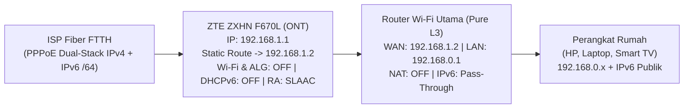
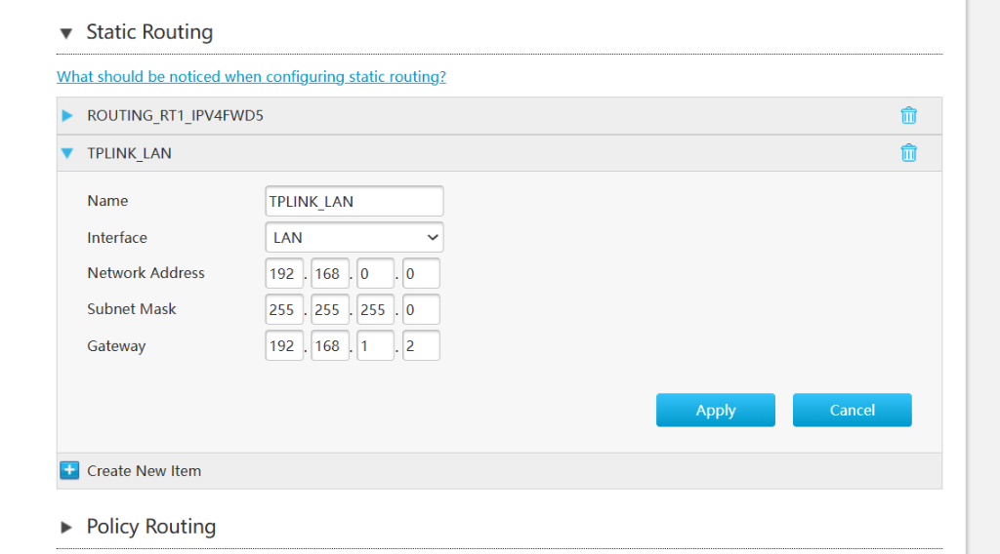
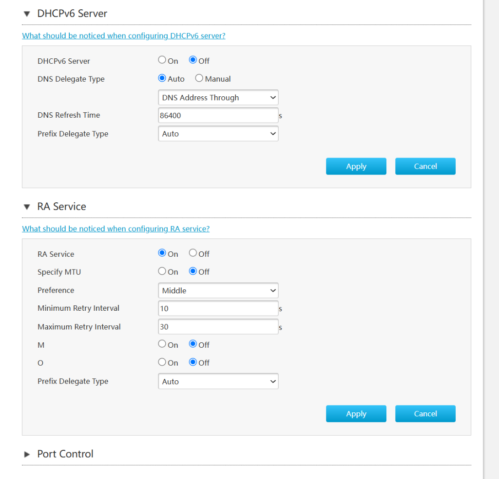
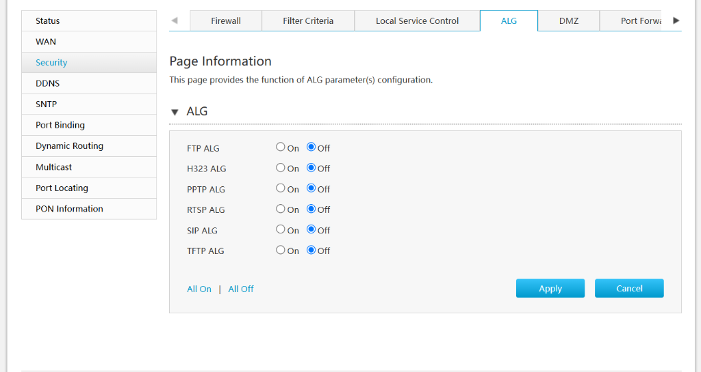
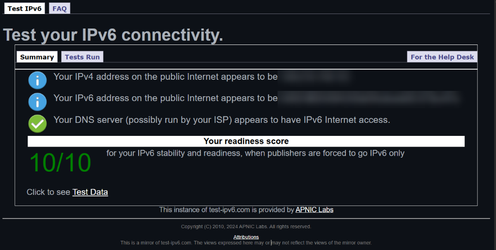

Salah satu *upgrade* paling masuk akal buat pengguna internet fiber rumahan di Indonesia adalah beli **router Wi-Fi tambahan** sendiri — entah itu TP-Link, Asus, Xiaomi, atau router Wi-Fi 6 lainnya — karena Wi-Fi bawaan modem ONT dari ISP sering kali jangkauannya pas-pasan dan gampang ngos-ngosan begitu dipakai banyak perangkat.

Masalahnya, kebanyakan orang (termasuk saya dulu) biasanya cuma langsung colok kabel LAN dari ONT **ZTE ZXHN F670L** ke port WAN router baru, setting nama Wi-Fi, lalu beres. Sekilas internet memang langsung jalan. Tapi kalau diperhatikan lebih teliti, konfigurasi "asal colok" seperti ini diam-diam meninggalkan empat penyakit klasik:

1. **Kena Double NAT:** Router tambahan melakukan NAT pertama (`192.168.0.x` → `192.168.1.2`), lalu ONT ZTE melakukan NAT kedua (`192.168.1.2` → IP publik/WAN ISP). Setiap paket data harus mengalami dua kali proses penulisan ulang *header* IP/port. Efeknya terasa di *game online* (NAT Type ketat/ping kurang stabil), panggilan suara/video, sampai beban CPU router yang nggak perlu.
2. **Bridge Mode Sering Terkunci:** Solusi buku teks untuk Double NAT memang *Bridge Mode*. Tapi di banyak ISP fiber Indonesia, ngubah ONT ke *Bridge Mode* sendiri hampir pasti bikin internet langsung mati karena ada **OMCI Lock / VEIP** (VLAN internet dikunci ke *Virtual Router Port* internal ONT) atau **MAC Lock / DHCP Option 60/61** di sisi ISP. Minta bukakan ke CS pun nggak selalu cepat atau diizinkan.
3. **IPv6 Tidak Kebuka (atau Malah Bikin Lemot):** Padahal banyak ISP fiber sekarang sudah menyalurkan IPv6 Dual-Stack, tapi perangkat di balik router tambahan sering nggak kebagian alamat IPv6 publik yang valid — atau parahnya dapat alamat kosong berawalan `::xxxx` yang bikin browser *loading* lebih lama karena harus menunggu *timeout* sebelum mundur ke IPv4.
4. **Wi-Fi Tabrakan & Beban Berlebih di ONT:** Wi-Fi bawaan ZTE yang dibiarkan tetap menyala di sebelah router baru bakal rebutan *channel* dan bikin interferensi. Ditambah lagi fitur **ALG (*Application Layer Gateway*)** dan firewall berlapis di ONT yang sering bikin panggilan *WhatsApp Call*, *Discord*, *Zoom*, sampai *CCTV IP Camera* jadi patah-patah.

Kabar baiknya: **kamu bisa membereskan semua masalah di atas langsung dari menu ZTE ZXHN F670L (firmware V9) dan router tambahanmu — tanpa perlu repot minta Bridge Mode ke ISP.**

---

## Hasil Nyata: Before vs. After

Sebelum masuk ke langkah teknisnya, ini gambaran perbedaan yang terasa setelah optimasi diterapkan pada jaringan rumah dengan ONT ZTE F670L dan router Wi-Fi 6 tambahan:

| Parameter | Sebelum Optimasi (Default) | Sesudah Optimasi |
| :--- | :--- | :--- |
| **Lapisan NAT Lokal** | Double NAT (Router + ONT) | **Single NAT** (*Pure Layer-3 Routing* di router tambahan) |
| **Konektivitas IPv6** | Tidak aktif / alamat tidak valid (`::xxxx`) | **Dual-Stack IPv6 `/64` aktif penuh** (`0% packet loss`, ping ~27 ms ke DNS IPv6 publik) |
| **Interferensi Wi-Fi** | Wi-Fi ONT & router utama sama-sama aktif | Wi-Fi ONT **OFF**; router utama bebas bekerja di 5 GHz `160 MHz` |
| **Kecepatan Wi-Fi (Speedtest)** | ~120–130 Mbps | **~205 Mbps** *(naik ~60% setelah bottleneck NAT & interferensi dibersihkan)* |

---

## Arsitektur Jaringan yang Kita Bangun

Prinsipnya sederhana: kita **bagi tugas dengan tegas** supaya kedua perangkat nggak saling tumpang tindih.



Dengan pola ini:
* **ZTE F670L** fokus sebagai gerbang fiber: dial PPPoE ke ISP, melakukan **satu-satunya NAT** ke internet, dan menyiarkan prefix IPv6 lewat SLAAC.
* **Router Wi-Fi tambahan** bekerja sebagai *Pure Layer-3 Router* (tanpa NAT ganda): tetap memegang penuh kendali Wi-Fi, pembagian IP (DHCP `192.168.0.x`), QoS, hingga *Parental Control*.

---

## Persiapan Sebelum Mulai

Luangkan 2 menit untuk mengecek lima hal ini dulu supaya prosesnya mulus tanpa drama internet mati:

### 1. Backup Konfigurasi ONT (Wajib!)
Masuk ke halaman admin ZTE F670L (`http://192.168.1.1`), lalu buka **`Management & Diagnosis` → `System Management` → `Backup Configuration`**. Unduh file backup-nya ke laptop/HP. Kalau nanti ada salah klik, kamu tinggal *restore* dalam hitungan detik.

### 2. Pastikan Punya Akses Menu Lanjutan di ZTE F670L
Pada firmware ZTE F670L V9, login menggunakan akun standar (`user`) biasanya menyembunyikan menu **`Static Routing`**, **`DMZ`**, dan **`ALG`**. Berikut rangkuman kredensial default/umum yang sering dipakai pada berbagai firmware bawaan ISP di Indonesia *(unit yang memakai password acak per-perangkat seperti Biznet Home dan MNC Play tidak dicantumkan)*:

| ISP | Username | Password Default / Umum | Catatan |
| :--- | :--- | :--- | :--- |
| **XL Satu / XL Home (eks First Media)** | `admin` | `@LN2021FmZTE`, `xlhome123`, `firstmedia`, `admin` | Sebagian unit baru memakai password unik di stiker modem / ACS |
| **IndiHome (Telkomsel)** | `admin` / `telecomadmin` | `Telkomdso123`, `admintelecom`, `Jm@Telkom`, `Web@0763` | Umum pada firmware lama; unit baru banyak yang sudah diacak ACS |
| **MyRepublic** | `admin` | `%0\|F?H@f!berhO3e`, `myrepublic` | Berlaku di firmware bawaan tertentu; dapat berubah setelah sinkronisasi OLT |
| **CBN** | `admin` | `Fs@1500879`, `Fs@1500892`, `Web@0063`, `cbn123` | Tergantung batch firmware |
| **Oxygen.id / Iconnet** | `admin` | `admin`, `Telkomdso123` | Tergantung batch firmware bawaan ZTE |

> Jika seluruh kredensial di atas tidak cocok, artinya ONT kamu sudah menggunakan password unik per-perangkat (cek stiker di bagian bawah modem) atau dikelola otomatis oleh server manajemen (ACS/TR-069) milik ISP.
{: .prompt-info }

### 3. Cek Status WAN & Dukungan IPv6 dari ISP
Buka menu **`Internet` → `Status`** di ZTE F670L. Pastikan profil WAN utama (contohnya `omci_ipv4_pppoe_1`) berstatus **`Connected`** dan sudah menerima alamat IPv6 publik (`GUA`) serta delegasi prefix (`PD /64`, misalnya `2001:db8:abcd::/64`).

### 4. Cek Fitur di Router Wi-Fi Tambahan
Pastikan router tambahanmu punya minimal dua fitur ini:
* Opsi mematikan NAT (**`Enable NAT: Off`**) saat berada di mode Router.
* Opsi IPv6 **`Pass-Through (Bridge)`**.

### 5. Skema IP yang Dipakai dalam Panduan Ini
Supaya gampang diikuti, kita pakai contoh subnet generik yang paling umum:
* **ONT ZTE F670L:** `192.168.1.1` (subnet `192.168.1.0/24`)
* **IP WAN Statis Router Tambahan:** `192.168.1.2`
* **LAN Router Tambahan:** `192.168.0.1` (subnet `192.168.0.0/24`)
* **Prefix IPv6 Publik ISP (contoh):** `2001:db8:abcd::/64`

*(Kalau router kamu pakai subnet lain, misalnya `192.168.50.0/24` di Asus, tinggal sesuaikan angkanya saja.)*

---

## Langkah 1: Hapus Double NAT dengan Static Routing

> **Aturan Urutan Wajib:** Selalu pasang **Static Route di ZTE terlebih dahulu**, baru setelah itu matikan **NAT di router tambahan**. Kalau urutannya terbalik, paket balasan dari internet tidak tahu jalan pulang ke `192.168.0.0/24` dan internet akan langsung putus!
{: .prompt-warning }

### 1.1. Kunci IP WAN Router Tambahan di `192.168.1.2`
Buka halaman pengaturan **WAN / Internet** di router Wi-Fi tambahanmu, lalu ubah tipe koneksi menjadi **Static IP**:
* **IP Address:** `192.168.1.2`
* **Subnet Mask:** `255.255.255.0`
* **Default Gateway:** `192.168.1.1`

*(Alternatif lainnya: kamu juga bisa mengunci IP tersebut dari sisi ZTE lewat menu **`Local Network` → `LAN` → `DHCP Binding`** berdasarkan MAC Address port WAN router tambahanmu.)*

### 1.2. Tambahkan 1 Baris Static Route di ZTE F670L
Sekarang kita "beri tahu" ZTE bahwa seluruh perangkat di jaringan `192.168.0.0/24` berada di belakang `192.168.1.2`:

1. Buka **`Internet` → `Routing` → `Static Routing`** (IPv4).
2. **Jangan sentuh atau ubah** entri *Default Route* (`0.0.0.0`) yang sudah ada.
3. Klik **`+ Create New Item`**, lalu isi persis seperti ini:
   * **Name:** `ROUTER_LAN` *(bebas, pendek tanpa spasi)*
   * **Interface:** `LAN`
   * **Network Address:** `192.168.0.0`
   * **Subnet Mask:** `255.255.255.0`
   * **Gateway:** `192.168.1.2`
4. Klik **`Apply`**.


_Contoh pengisian Static Routing di ZTE F670L (Interface: LAN, mengarahkan 192.168.0.0/24 ke Gateway 192.168.1.2)._

### 1.3. Matikan NAT di Router Wi-Fi Tambahan
Setelah Static Route di ZTE tersimpan, sekarang giliran router utamamu:
* Di router seperti TP-Link Archer, masuk ke **`Advanced` → `Network` → `Internet`** (atau **`Advanced` → `NAT Forwarding`**).
* Hilangkan centang pada **`Enable NAT`**, lalu klik **`Save`**.

Selesai! Router kamu sekarang berjalan di mode *Pure Layer-3* — DHCP, Wi-Fi, QoS, dan fitur kontrol orang tua tetap aktif normal, tapi tidak lagi bikin Double NAT.

> **Gimana kalau router saya nggak punya opsi `Enable NAT: Off`?**
> Tenang, kamu tetap bisa bebas Double NAT dengan mengubah mode operasi router tambahan ke **Access Point (AP) Mode**. Bedanya, di AP Mode seluruh pembagian IP (DHCP), QoS, dan *Parental Control* akan dikembalikan ke ONT ZTE, sedangkan router tambahanmu murni fokus memancarkan sinyal Wi-Fi.
{: .prompt-tip }

---

## Langkah 2: Buka Koneksi Dual-Stack IPv6 (SLAAC Murni)

Banyak orang mengira mengaktifkan IPv6 itu cukup centang "On" saja. Padahal di ZTE F670L, kombinasi *flag* di menu LAN IPv6 menentukan apakah IPv6 berjalan mulus atau malah bikin konflik DNS.

### 2.1. Atur LAN IPv6 di ZTE F670L
Buka menu **`Local Network` → `LAN` → `IPv6`**, lalu sesuaikan tiga bagian ini:

1. **Prefix / Delegate:**
   * **Prefix Delegate Type:** **`Auto`**
   * **Static Prefix:** **Kosongkan** *(jangan diisi manual, karena prefix dari ISP bersifat dinamis dan berubah tiap ONT restart)*.
2. **DHCPv6 Server:**
   * **DHCPv6 Server:** **`Off`**
   * *Kenapa dimatikan?* Supaya ONT tidak memaksa membagikan DNS IPv6 milik ISP yang sering memicu konflik resolusi DNS (IPv4 vs. IPv6) atau menimpa DNS pilihan pengguna (misalnya kalau kamu pakai Cloudflare `1.1.1.1`, Google DNS, atau AdGuard DNS di router/perangkat).
3. **RA Service (Router Advertisement):**
   * **RA Service:** **`On`**
   * **Managed Flag (`M`):** **`Off`**
   * **Other Config Flag (`O`):** **`Off`**
4. Klik **`Apply`**.


_Pengaturan LAN IPv6 di ZTE F670L: DHCPv6 Server Off, RA Service On dengan Flag M dan O Off, serta Prefix Delegate Type Auto._

Kombinasi `RA: On`, `M: Off`, `O: Off`, dan `DHCPv6: Off` ini mengaktifkan **SLAAC murni** (*Stateless Address Autoconfiguration*). Artinya, setiap HP, laptop, dan Smart TV di rumah akan otomatis membentuk alamat IPv6 publik yang valid langsung dari prefix `/64` ISP tanpa perlu repot lewat DHCPv6.

### 2.2. Set IPv6 ke `Pass-Through (Bridge)` di Router Tambahan
1. Buka menu **`IPv6`** (atau **`Advanced` → `IPv6`**) di router Wi-Fi tambahanmu.
2. Aktifkan **IPv6**, lalu pilih tipe koneksi **`Pass-Through (Bridge)`**.
3. Klik **`Save`**.

Mode *Pass-Through* akan meneruskan paket *Router Advertisement (RA)* dari ZTE langsung ke seluruh perangkat yang terhubung ke Wi-Fi dan LAN router utamamu.

---

## Langkah 3: Pangkas Beban ONT & Tuning Dasar Wi-Fi 6

Karena ZTE F670L sekarang hanya bertugas sebagai gerbang fiber dan routing keluar, fitur-fitur tambahan di dalamnya sebaiknya dimatikan agar prosesornya lega, suhu lebih adem, dan tidak mengganggu trafik router utama.

### 3.1. Yang Perlu Dimatikan di ZTE F670L

| Jalur Menu di ZTE F670L | Fitur / Field | Pengaturan | Dampak ke Jaringan Rumah |
| :--- | :--- | :---: | :--- |
| **`Local Network` → `WLAN` → `WLAN Basic`** | Radio `2.4 GHz` & `5 GHz` | **`Off`** | Menghilangkan interferensi sinyal di dekat router utama & bikin suhu ONT jauh lebih adem |
| **`Internet` → `Security` → `ALG`** | `SIP ALG`, `H323 ALG`, `RTSP ALG` | **`Off`** | Mencegah suara putus sebelah (*one-way audio*) di WhatsApp Call/Discord/Zoom, gangguan game online, dan *freezing* pada CCTV IP Camera |
| **`Internet` → `Security` → `Firewall`** | Level Firewall / Inspeksi berlebih | **`Low` / `Off`** | Mengurangi beban CPU ONT *(perangkat rumah tetap terlindungi oleh NAT IPv4 & firewall bawaan OS masing-masing)* |


_Menu Internet → Security → ALG di ZTE F670L dengan seluruh saklar ALG dimatikan (bisa langsung klik pintasan All Off lalu Apply)._

### 3.2. Checklist Tuning Dasar di Router Wi-Fi 6 Utama
Supaya kenaikan *throughput* Wi-Fi makin maksimal setelah bottleneck NAT hilang, cek juga setelan dasar ini di router utamamu:
* **Band 2.4 GHz:** Gunakan Channel **`1`**, **`6`**, atau **`11`** (pilih yang paling sepi) dengan Channel Width **`20 MHz`** — paling stabil untuk tembus tembok dan perangkat IoT.
* **Band 5 GHz:** Gunakan Channel **`36`** *(Non-DFS, jadi nggak bakal tiba-tiba putus kalau ada deteksi radar)* dengan Channel Width **`160 MHz`** (turunkan ke `80 MHz` kalau rumahmu di apartemen/lingkungan Wi-Fi sangat padat).
* **OFDMA:** **`On`** — sangat membantu mengatur antrean data saat banyak HP/laptop aktif bersamaan.
* **WPS:** **`Off`** — tutup celah keamanan yang jarang terpakai.
* **Flow Control (Ethernet):** **`Off`** — mencegah *pause frame* menurunkan kecepatan transfer antar port Gigabit.

---

## Drama & Troubleshooting yang Sering Kejadian

Bagian ini penting banget untuk dibaca sebelum atau saat kamu ngoprek, karena beberapa jebakan di bawah ini benar-benar sering kejadian di firmware ZTE V9:

> **PERINGATAN KERAS soal Halaman WAN ZTE V9:**
> Di halaman **`Internet` → `WAN`** (profil `omci_ipv4_pppoe_1`), kolom password PPPoE pada firmware ZTE V9 sering tampil kosong/ter-masking (`encode="1"`). **Jangan pernah klik `Apply` di halaman WAN PPPoE** kalau kamu tidak memegang username & password PPPoE asli dari ISP — karena klik `Apply` bisa menimpa password PPPoE dengan teks kosong dan membuat internet langsung mati total! Kalau terlanjur kejadian, segera *restore* dari file *Backup Configuration*.
{: .prompt-danger }

Selain jebakan WAN di atas, ini rangkuman kendala lain yang paling sering ditemui:

| Gejala / Kendala | Penyebab | Solusi |
| :--- | :--- | :--- |
| **Internet langsung putus setelah mematikan NAT di router utama** | `Enable NAT` dimatikan sebelum Static Route di ZTE aktif, sehingga paket balasan dari internet dibuang ZTE. | Nyalakan kembali `Enable NAT` sementara, pastikan Static Route (`192.168.0.0/24 -> 192.168.1.2`, `Interface: LAN`) sudah di-`Apply` di ZTE, baru matikan NAT lagi. |
| **Dapat alamat IPv6 aneh berawalan `::` (misal `::7c7a:...`) & browsing terasa lambat** | Mode `Pass-Through (Bridge)` di router utama belum tersimpan, atau ISP hanya memberi alamat WAN tanpa *Prefix Delegation (`PD`)* sehingga ZTE menyiarkan prefix kosong `::/64`. | Pastikan `Pass-Through` sudah di-`Save` dan `Prefix Delegate Type` di ZTE pada posisi **`Auto`**. Jika setelah *reconnect* alamat tetap `::xxxx`, artinya ISP memang belum memberi `PD` — matikan IPv6 di router utama supaya browser tidak kena *delay* fallback. |
| **IPv6 mati sendiri setelah mati lampu / ONT restart** | Prefix IPv6 sempat diketik manual ke kolom **`Static Prefix`**, padahal prefix ISP berubah tiap *reconnect*. | Kosongkan **`Static Prefix`** dan gunakan **`Prefix Delegate Type: Auto`**. |
| **Menu `Static Routing`, `DMZ`, atau `ALG` tidak muncul** | Masih login memakai akun standar (`user`). | Login menggunakan akun dengan hak akses konfigurasi lanjutan, atau konsultasikan ke ISP. |
| **Tidak bisa buka web admin ZTE (`192.168.1.1`) dari Wi-Fi router (`192.168.0.x`)** | *Gateway* pada Static Route salah, atau *Service Control* ZTE memblokir akses HTTP dari subnet lain. | Cek ulang *Gateway* di Static Route (harus persis IP WAN router `192.168.1.2`) dan pastikan akses LAN tidak diblokir di `Internet → Security → Service Control`. |

---

## Cara Cek Hasilnya (3 Tes Cepat)

Setelah semua tersimpan, lakukan tiga tes ringan ini dari laptop atau HP yang tersambung ke Wi-Fi router utamamu (`192.168.0.x`):

### 1. Cek Bebas Double NAT (`tracert`)
Buka Command Prompt / PowerShell di Windows (atau Terminal di macOS/Linux), lalu jalankan:

```text
tracert -d 1.1.1.1
```
*(Untuk macOS/Linux: `traceroute -n 1.1.1.1`)*

Hasil yang sehat kurang lebih terlihat seperti ini:

```text
  1    <1 ms    <1 ms    <1 ms  192.168.0.1    <-- Router Wi-Fi utama (Pure L3)
  2     1 ms     1 ms     1 ms  192.168.1.1    <-- ONT ZTE F670L (Single NAT keluar)
  3     5 ms     4 ms     5 ms  <IP Gateway ISP>
```

Hop 1 langsung ke router utama, hop 2 ke ZTE F670L, dan hop 3 langsung masuk jaringan ISP dengan latensi rendah tanpa ada *Request timed out* di hop lokal.

### 2. Cek Koneksi IPv6 Dual-Stack
* **Lewat Browser:** Buka **[test-ipv6.com](https://test-ipv6.com)** — pastikan skor menyentuh **10/10** dan alamat IPv6 yang tampil adalah alamat publik yang valid (bukan berawalan `::` atau `fe80::`).
* **Lewat Terminal / CMD:**
  ```text
  ping -6 2001:4860:4860::8888
  ```
  Jika muncul balasan stabil seperti `time=27ms` dengan `0% loss`, jalur IPv6 rumahmu sudah resmi terbuka penuh!


_Hasil pengujian di test-ipv6.com setelah optimasi: skor 10/10 dengan koneksi Dual-Stack IPv4 dan IPv6 publik aktif penuh (IP publik disensor)._

### 3. Cek Kecepatan & Kestabilan Wi-Fi
Jalankan **[Speedtest.net](https://www.speedtest.net)** atau **[Fast.com](https://fast.com)** di jaringan Wi-Fi 5 GHz. Perhatikan bukan cuma angka *download/upload*, tapi juga *loaded latency* (ping saat mengunduh) — koneksi yang sudah bebas Double NAT dan interferensi biasanya terasa jauh lebih stabil dan responsif.

---

## Penutup

Memaksimalkan modem bawaan ISP seperti **ZTE ZXHN F670L** ternyata tidak selalu harus menunggu *Bridge Mode* dibuka oleh CS. Dengan kombinasi **1 baris Static Route**, **SLAAC murni untuk IPv6**, dan **mematikan Wi-Fi serta ALG bawaan ONT**, jaringan rumah bisa jauh lebih bersih, adem, dan kencang.

Satu tips terakhir: simpan catatan kecil berisi **3 langkah inti** (matikan Wi-Fi ZTE, isi ulang 1 baris Static Route, dan atur LAN IPv6 SLAAC). Jadi kalau suatu hari ONT di-reset pabrik oleh teknisi ISP, kamu cuma butuh kurang dari 5 menit untuk mengembalikan semuanya seperti semula. Selamat mencoba!
