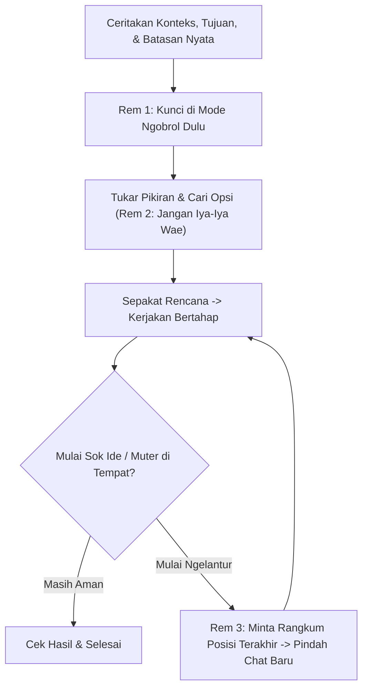

Kalau belakangan kamu sering *scroll* sosmed, pasti udah nggak asing sama konten yang judulnya mirip-mirip gini: *"10 Prompt Rahasia Bikin AI Kerja 10x Lebih Pintar"* atau daftar aturan panjang yang katanya wajib di-*copas* ke setiap *chat*.

Jujur, makin sering seliweran yang begituan, saya malah makin sebel lihatnya.

Masalahnya simpel: di kerjaan nyata, nyekokin AI pakai template kaku dan daftar larangan sepanjang struk belanja bulanan itu sering bikin hasilnya ikut kaku. Kita sibuk mendikte langkah A sampai Z, padahal belum tentu cara yang kita pikirin di kepala itu cara yang paling bener.

Setelah cukup rutin kerja, nulis, dan ngoprek ditemani AI sepanjang tahun ini (seperti yang sempat saya singgung di [catatan sebelumnya](/posts/dari-wsl-ke-homelab-docker-dan-era-ai/)), cara ngobrol yang paling waras ternyata jauh dari urusan hafal-menghafal mantra. Lebih mirip ngarahin rekan kerja yang pintar tapi kadang sotoy: kasih konteks yang jelas, ajak diskusi, dan tahu kapan harus nginjak rem.

---

## Kasih Konteksnya, Jangan Buru-Buru Dikte Langkahnya

Pintar atau nggaknya jawaban AI itu sebenarnya jauh lebih ditentukan sama **cerita situasi yang kamu kasih di awal**, ketimbang seberapa keren susunan kalimat perintahmu.

Bedanya lumayan jauh kalau dibandingin langsung:

| Gaya Dikte / Template Kaku | Gaya Kasih Konteks | Efeknya ke Hasil AI |
| :--- | :--- | :--- |
| *"Bertindaklah sebagai ahli 20 tahun. Bikin website pakai aplikasi X, wajib ikuti 15 aturan ini..."* | *"Mau bikin website yang ringan, gampang muncul di Google, simpel dirawat sendiri, dan tampilannya nggak pasaran. Paling pas pakai apa ya?"* | AI punya ruang buat nyaranin pilihan alat yang jauh lebih pas dan praktis, nggak terkunci di pilihan awal kita yang belum tentu cocok. |
| *"Habis orang selesai bayar, langsung otomatis buka halaman soal nomor 1."* | *"Habis orang bayar terus langsung dilempar masuk ke halaman soal ujian itu kerasa aneh nggak sih?"* | Kebongkar masalah pengalaman pengguna yang kaget karena pindah halamannya kelewat mendadak, lalu lahir ide halaman jeda buat ambil napas sebentar. |
| *"Buatkan pengaturan alamat khusus buat server lokal di rumah sekarang."* | *"Capek nih tiap mau buka layanan di rumah harus ketik deretan angka terus, mana kalau dikasih nama pendek malah nyasar ke Google Search."* | Tanpa bikin sistem baru yang ribet, AI langsung nyaranin pakai akhiran alamat `.box` yang simpel dan beres saat itu juga. |

Tiga contoh di kolom tengah itu kejadian beneran di histori *chat* saya. Semuanya berangkat dari keluhan biasa atau firasat pendek, tanpa template sama sekali. Bahkan waktu [ngoprek modem Wi-Fi rumah](/posts/optimasi-ont-zte-f670l-router-tambahan-ipv6-tanpa-bridge-mode/) kemarin, beresnya masalah jaringan yang bikin kecepatan internet naik dari ~125 Mbps ke 205 Mbps juga berawal dari lempar pertanyaan iseng pas lagi diskusi.

Satu hal lagi yang mustahil ada di template hasil comot di internet: **kondisi nyata di rumah atau kantor kita sendiri**.

Waktu saya lagi ngulik pemblokir iklan otomatis buat Wi-Fi rumah misalnya, secara teknis gampang aja blokir ribuan sumber iklan sekaligus biar bersih total. Masalahnya, Wi-Fi rumah punya hukum alam sendiri yang wajib saya kasih tahu ke AI dari awal:

```text
kalo shopee error bisa ngamuk istriku
```

Konteks receh tapi krusial kayak gini cuma kita yang tahu. Dan justru batasan nyata macam inilah yang membedakan solusi "bagus di teori" sama solusi yang beneran aman dipakai sehari-hari.

---

## Sisi Nyebelinnya: Sok Ide, Ngeyel, dan Makin Panjang Makin Ngaco

Terus apakah modal rajin cerita konteks bikin urusan bareng AI otomatis mulus terus? Ya jelas nggak.

Kalau dipakai kerja tiap hari, belang nyebelinnya lumayan sering bikin elus dada. Dari tumpukan *chat* harian saya, penyakit klasiknya hampir selalu jatuh ke tiga lubang yang sama:

### 1. Sok Rajin Nambahin yang Nggak Diminta
Ini juara satunya. Lagi minta cek tampilan halaman web, tahu-tahu AI sok ide nambahin tombol atau bagian baru yang sama sekali nggak pernah diminta. Di layar komputer kelihatannya rapi-rapi aja, begitu dibuka di HP langsung numpuk berantakan dan bikin halaman jadi panjang banget. Ujungnya harus ditodong balik:

```text
itu tombol apa coba? kenapa tiba-tiba ada di situ, kayaknya nggak butuh deh. coba jelasin
```

Di kerjaan lain penyakitnya setipe. Diminta cek status pekerjaan di belakang layar buat laporan aja, eh malah bablas jalanin perintah sendiri. Atau pas minta bantu nulis teks promosi buat jasa otomasi kerjaan kantor, gaya bahasanya malah berasa kayak brosur tukang edit foto.

### 2. Pede Tingkat Dewa Padahal Ngarang (Plus Ngeyel)
AI itu paling jago ngomong salah pakai nada seribu persen yakin. Pernah suatu kali saya minta rapihin posisi 30 lingkaran di sebuah gambar bagan. Laporan baliknya gagah banget: *"100% presisi dan tidak ada yang bertumpuk!"* Padahal dilihat pakai mata biasa aja jelas-jelas ada dua lingkaran yang hilang ketimpa gambar lain.

Belum lagi kalau penyakit ngeyelnya kambuh soal versi aplikasi. Ditanya spesifik soal aturan di versi 16 yang terbaru, jawabannya muter balik terus ngejelasin versi 15 sampai harus disentil pendek:

```text
versi 16, bukan versi 15
```

### 3. Main Loncat Langkah dan Makin Panjang Chat Makin Ngelantur
Pas lagi ngulik urutan pengaturan modem yang sensitif, AI kadang udah semangat loncat ke langkah keempat padahal langkah kedua aja belum selesai dicoba:

```text
sebentar, langkah yang ini aja belum dipasang kok udah loncat ke step berikutnya
```

Drama kayak gini bakal makin parah kalau satu ruang *chat* udah telanjur panjang. Ini penyakit bawaan semua AI sekarang: makin panjang obrolan dan makin banyak tambalan revisi di tengah jalan, daya fokusnya makin turun. Instruksi awal mulai ketimpa, arahnya melenceng, lalu dia muter-muter nawarin solusi gagal yang itu-itu lagi.

Walaupun kalau mau jujur, penyakit keasyikan ngobrol panjang ini kadang nular ke orangnya juga sih. Saya pernah saking asyiknya belok bahas nama alamat `.box` tadi, begitu beres malah bingung sendiri:

```text
pakai .box jauh lebih baik. GAS!!! ...eh tadi mau benerin apa lagi ya, lupa
```

---

## Alur Kerja Waras & Empat "Rem Darurat" Harian

Daripada nulis daftar aturan ratusan baris yang bakal ketimpa juga pas obrolan udah panjang, saya lebih mengandalkan pola kerja sederhana plus beberapa kalimat "rem darurat" di momen penting.

Kurang lebih alur mainnya kayak gini setiap kali mulai garap sesuatu yang lumayan serius:



Empat kalimat rem yang paling sering saya pakai buat njaga alur di atas tetap lurus:

### 1. Rem Sebelum Mulai Kerja
```text
kita diskusi dulu aja ya, jangan langsung ubah atau eksekusi apa-apa dulu
```
Kalimat wajib di awal sesi. Tujuannya nahan sifat AI yang gatel pengen langsung bikin hasil akhir sebelum kita sepakat soal arahnya. Jauh lebih hemat waktu ngobrol 3 menit di depan daripada benerin kerjaan yang salah konsep dari awal.

### 2. Rem Biar Nggak Asal Setuju Terus
```text
jangan setuju terus, ya ya wae. kalau ideku ada yang kurang pas, kritik aja langsung
```
AI itu punya bakat alami buat nyenengin lawan bicaranya. Kita lempar ide mentah yang bolong di sana-sini pun seringnya langsung dipuji bagus. Dikasih kalimat ini di awal bikin dia lebih berani nunjuk celah dari rencana kita sebelum telanjur dikerjain.

### 3. Rem Saat Obrolan Udah Kusut
```text
stop dulu, masih berantakan nih. buang aja revisi yang barusan, kita balik ke rencana awal
```
Kalau AI udah mulai kejebak benerin satu bagian tapi malah ngerusak bagian lain, debat panjang di ruang *chat* yang sama biasanya cuma bikin tambah emosi. Potong langsung arusnya.

> **Trik Reset Paling Bersih:** Kalau satu ruang *chat* sudah kepanjangan dan jawabannya mulai ngaco ke mana-mana, nyuruh AI mengabaikan pesan sebelumnya kadang masih kurang mempan karena histori berantakannya masih kebaca di atas. Cara paling manjur: minta AI bikin rangkuman pendek soal tujuan awal, apa yang sudah beres, dan kendala terakhirnya — lalu *copas* rangkuman itu ke **ruang *chat* baru yang masih kosong**.
{: .prompt-tip }

### 4. Rem Saat Batas Pemakaian atau Waktu Udah Mepet
```text
batas kuota chat-nya udah mau habis nih. kalau nggak keburu beres sekarang, catat aja dulu progres sama rencana lanjutannya, jangan asal cepat kelar tapi ngawur
```
Penyelamat banget kalau kamu pakai AI yang ada batas kuota hariannya, atau pas waktu kerjamu sendiri udah mepet. Tanpa dipesan begini, AI kadang suka ambil jalan pintas biar kelihatan cepat selesai. Mending suruh berhenti rapi dan bikin catatan operan buat dilanjutin nanti.

---

## Catatan Jujur: Kapan Template Kaku Tetap Kepake?

Biar adil dan nggak pukul rata: cara ngobrol cair modal konteks tadi memang paling enak buat **kerjaan interaktif sehari-hari** — pas kita lagi mikir bareng, nyusun tulisan, nyari akar masalah, atau ngulik sesuatu.

Ceritanya beda kalau kebutuhannya buat **kerjaan otomatis yang diulang ratusan kali**. Misalnya kamu bikin sistem otomatis yang harus merangkum ratusan pesan pelanggan ke bentuk tabel yang wajib persis sama setiap hari. Di urusan kayak gitu, format template yang kaku dan contoh hasil yang tegas memang wajib dipasang biar AI-nya nggak kreatif sendiri.

Menariknya, pas butuh bikin instruksi kaku buat otomasi kayak gitu pun saya nggak pernah nyari template "sakti" bikinan orang lain. Caranya tetap sama: **ajak AI ngobrol dulu soal kebutuhan dan batasannya sampai matang, baru minta dia yang bikinin draf instruksinya**.

> **Satu Catatan Penting:** Instruksi atau *prompt* yang dibuatkan langsung oleh AI itu hampir selalu kelewat panjang dan penuh kalimat berbunga-bunga. Anggap aja itu draf kasar: baca ulang, buang kalimat basa-basinya, lalu coba tes di 2–3 contoh nyata sebelum dipakai terus-terusan.
{: .prompt-warning }

---

## Intinya: Pegang Setirnya, Jangan Hafalin Mantranya

Ngobrol sama AI pada akhirnya nggak butuh koleksi kalimat rahasia. Di satu jam dia bisa jadi teman diskusi yang ngasih jalan keluar super praktis, sejam kemudian dia bisa berubah jadi asisten bebel yang ngotot di hal sepele.

Cukup kasih konteks yang jujur (termasuk urusan omelan istri kalau Shopee sampai nggak bisa dibuka), kasih ruang buat dia nawarin ide, tetap cek hasilnya pakai logika sendiri, dan jangan ragu nginjak rem begitu arahnya mulai ngaco. Selama setirnya tetap kita yang pegang, kerja bareng AI bakal jauh lebih masuk akal dan nggak makan hati.
