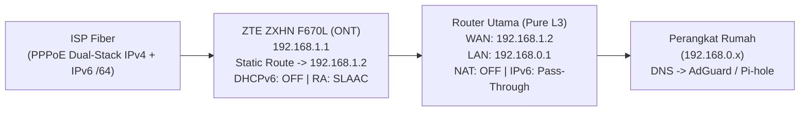

# Optimasi Modem ONT ZTE ZXHN F670L (First Media): Bebas Double NAT, IPv6 Dual-Stack, & Ramah Adblocker Tanpa Bridge Mode

Banyak pengguna internet fiber di Indonesia (seperti First Media) yang dibekali ONT **ZTE ZXHN F670L** lalu menambahkan router Wi-Fi sendiri (misalnya TP-Link, Asus, atau MikroTik) untuk performa Wi-Fi dan manajemen jaringan yang lebih baik.

Masalahnya, jika router tambahan langsung dicolok begitu saja tanpa penyesuaian di sisi ZTE F670L, biasanya muncul tiga kendala klasik:
1. **Double NAT** — perangkat di rumah berada di balik dua lapis NAT (NAT router sendiri + NAT ZTE), yang sering mengganggu game online, akses homelab, dan VPN.
2. **IPv6 bermasalah atau mem-bypass Adblocker** — saat IPv6 dinyalakan, DHCPv6 bawaan ONT sering membagikan DNS IPv6 milik ISP sehingga iklan kembali tembus melewati Pi-hole / AdGuard Home.
3. **Overhead & interferensi ONT** — Wi-Fi bawaan ONT, ALG, dan firewall berlapis membebani prosesor kecil di ZTE dan mengganggu sinyal Wi-Fi router utama.

Kabar baiknya: **kita bisa membereskan semua ini langsung di ZTE ZXHN F670L tanpa harus repot meminta Bridge Mode ke ISP.**

---

## Arsitektur Jaringan yang Kita Bangun

Dengan skema ini, **ZTE F670L** tetap bertugas melakukan dial PPPoE dan satu-satunya NAT ke internet, sementara **router utama** bekerja sebagai *Pure Layer-3 Router* tanpa Double NAT.

---

## Referensi Akses Login ZTE F670L (Berbagai ISP di Indonesia)

Sebelum memulai konfigurasi, Anda perlu login ke halaman admin ONT (umumnya di `http://192.168.1.1`). Berikut rangkuman kredensial default/umum yang banyak digunakan pada firmware bawaan ZTE F670L *(unit yang menggunakan password acak/unik per-device seperti Biznet Home dan MNC Play tidak dicantumkan)*:

| ISP | Username | Password Default / Umum | Catatan | Referensi |
| :--- | :--- | :--- | :--- | :--- |
| **XL Home / XL Satu (eks First Media)** | `admin` | `@LN2021FmZTE` *(eks First Media)*, `xlhome123`, `firstmedia`, `admin` | Campuran; sebagian unit baru memakai password unik di stiker modem / ACS | [xkomo](https://xkomo.com/username-dan-password-router-zte-f670l-series), [XL Home](https://home.xl.co.id/berita-dan-artikel/cara-ganti-password-wifi-rumah-xl-satu) |
| **IndiHome (Telkomsel)** | `admin` / `telecomadmin` | `Telkomdso123`, `admintelecom`, `Jm@Telkom`, `Web@0763` *(user lama)* | Umum pada firmware lama/offline; unit aktif 2025–2026 banyak yang sudah diacak ACS | [Sepoin](https://www.sepoin.com/login-zte-f670l-user-dan-password-superadmin/), [Kumparan](https://kumparan.com/how-to-tekno/password-zte-f670l-dan-username-untuk-atasi-masalah-login-27ZlcJWt97f) |
| **MyRepublic** | `admin` | `%0\|F?H@f!berhO3e`, `myrepublic` | Berlaku di firmware bawaan tertentu; dapat berubah setelah sinkronisasi OLT/ACS | [xkomo](https://xkomo.com/username-dan-password-router-zte-f670l-series), [Indihome.web.id](https://indihome.web.id/blog/username-dan-password-bawaan-wifi/) |
| **CBN** | `admin` | `Fs@1500879`, `Fs@1500892`, `Web@0063`, `cbn123` | Berlaku di batch firmware tertentu; dapat ditimpa server manajemen ISP | [Sepoin](https://www.sepoin.com/login-zte-f670l-user-dan-password-superadmin/), [xkomo](https://xkomo.com/username-dan-password-router-zte-f670l-series) |
| **Oxygen.id / Iconnet** | `admin` | `admin`, `Telkomdso123` *(bawaan pabrik ZTE)* | Tergantung batch firmware ONT | — |

> [!NOTE]
> Jika seluruh kredensial default di atas tidak cocok, artinya ONT Anda sudah menggunakan password unik per-device (tertera di stiker bawah modem) atau dikelola secara otomatis oleh server ACS/TR-069 ISP.

---

## Langkah 1: Eliminasi Double NAT dengan Static Routing

Alih-alih membiarkan router utama melakukan NAT lagi, kita cukup "memberi tahu" ZTE F670L bahwa seluruh jaringan `192.168.0.0/24` berada di belakang IP WAN router utama (`192.168.1.2`).

### Yang dilakukan di ZTE ZXHN F670L (`http://192.168.1.1`):
1. **Pastikan IP WAN Router Utama Statis (`192.168.1.2`)**
   - Bisa diatur lewat *DHCP Binding / Reservation* di ZTE atau diset *Static IP* di menu WAN router utama (`IP: 192.168.1.2`, `Mask: 255.255.255.0`, `Gateway: 192.168.1.1`).
2. **Tambahkan Static Route di ZTE**
   - Masuk ke menu **Internet / Network → Routing → Static Routing** (IPv4).
   - Tambahkan entri baru:
     - **Destination Network:** `192.168.0.0`
     - **Subnet Mask:** `255.255.255.0`
     - **Gateway / Next Hop:** `192.168.1.2`
     - **Interface:** `LAN`
3. **Matikan NAT di Router Utama**
   - Setelah Static Route di ZTE tersimpan, matikan fitur **NAT (`NAT: OFF`)** di router utama Anda.

> [!TIP]
> **Cara verifikasi:** Jalankan `tracert 1.1.1.1` (Windows) atau `traceroute 1.1.1.1` (Linux/macOS). Paket akan mengalir mulus dari `192.168.0.1` → `192.168.1.1` → langsung ke gateway ISP, tanpa ada terjemahan NAT ganda di tengah jalan.

---

## Langkah 2: Aktifkan Dual-Stack IPv6 Tanpa Membocorkan DNS ISP

Bagian ini paling sering bikin pengguna Pi-hole atau AdGuard Home pusing: begitu IPv6 menyala, tiba-tiba iklan muncul lagi karena perangkat menerima **DNS IPv6 langsung dari DHCPv6 ONT**.

Kuncinya adalah menggunakan **SLAAC murni** di ZTE F670L dan mematikan DHCPv6 Server-nya.

### Yang dilakukan di ZTE ZXHN F670L:
1. **Pastikan WAN Dual-Stack Aktif**
   - Pada profil WAN PPPoE (contoh: `omci_ipv4_pppoe_1` pada VLAN `1111`), pastikan mode **IPv4/IPv6** aktif dan **Prefix Delegation (Auto PD `/64`)** berjalan sehingga ONT mendapat prefix IPv6 publik dari ISP.
2. **Atur LAN IPv6 (Bagian Paling Penting)**
   - Masuk ke menu **Local Network → LAN → IPv6**:
     - **DHCPv6 Server:** **`OFF`** *(mencegah ONT menyebarkan DNS IPv6 ISP)*
     - **Router Advertisement (RA):** **`ON`**
     - **Flag `M` (Managed Address Configuration):** **`OFF`**
     - **Flag `O` (Other Configuration):** **`OFF`**
3. **Di Sisi Router Utama:**
   - Ubah mode IPv6 router utama ke **Pass-Through (Bridge)**.

Hasilnya: seluruh HP dan PC di rumah langsung mendapatkan **IPv6 publik yang valid**, tetapi seluruh permintaan DNS tetap masuk ke DNS IPv4 lokal (AdGuard Home / Pi-hole) tanpa ada kebocoran ke DNS ISP.

---

## Langkah 3: Pangkas Overhead & Interferensi di ZTE F670L

Karena ZTE F670L kini hanya fokus sebagai gerbang fiber dan routing keluar, fitur-fitur tambahan bawaan ONT sebaiknya dimatikan agar suhu lebih adem, CPU lega, dan tidak mengganggu jaringan:

| Menu / Fitur di ZTE F670L | Pengaturan | Manfaat |
| :--- | :---: | :--- |
| **WLAN / Wi-Fi (2.4 GHz & 5 GHz)** | **OFF** | Menghilangkan interferensi sinyal dengan router Wi-Fi 6 utama & mengurangi panas ONT |
| **ALG (SIP, FTP, PPTP, H.323, dll.)** | **OFF** | Mencegah paket VPN (Tailscale/WireGuard), VoIP, dan game rusak karena di-rewrite oleh ONT |
| **Firewall / DoS Protection berlebih** | **OFF / Low** | Mengurangi beban prosesor ONT dan potensi *false positive* pada trafik homelab/VPN |

---

## Ringkasan Perubahan (Before vs. After)

| Aspek | Sebelum Optimasi (Default) | Sesudah Optimasi ZTE F670L |
| :--- | :--- | :--- |
| **Routing / NAT** | Double NAT (Router + ZTE) | **Single NAT** (Static Route di ZTE + Pure L3 Router) |
| **IPv6** | Nonaktif / Bocor DNS ISP | **Dual-Stack IPv6 `/64` (SLAAC murni)**, aman untuk Adblocker |
| **Wi-Fi ONT** | Menyala (interferensi channel) | **OFF** (100% ditangani router utama) |
| **ALG & Firewall ONT** | Aktif (rawan ganggu VPN/Tailscale) | **OFF** (trafik bersih & stabil) |
| **Throughput Wi-Fi** | ~120–130 Mbps | **~205 Mbps** *(setelah interferensi & bottleneck dibersihkan)* |

---

## Catatan Penting Sebelum Mencoba

> [!WARNING]
> 1. **Backup konfigurasi ZTE terlebih dahulu** (menu *Management & Diagnosis → System Management → Backup Configuration*) sebelum mengubah pengaturan routing atau IPv6.
> 2. Jika suatu saat ONT di-reset pabrik oleh teknisi ISP, Anda hanya perlu mengulang **3 langkah utama**: matikan Wi-Fi ZTE, masukkan ulang 1 baris Static Route (`192.168.0.0/24 -> 192.168.1.2`), dan set IPv6 LAN (`DHCPv6: OFF`, `RA: ON`, `M: OFF`, `O: OFF`).
